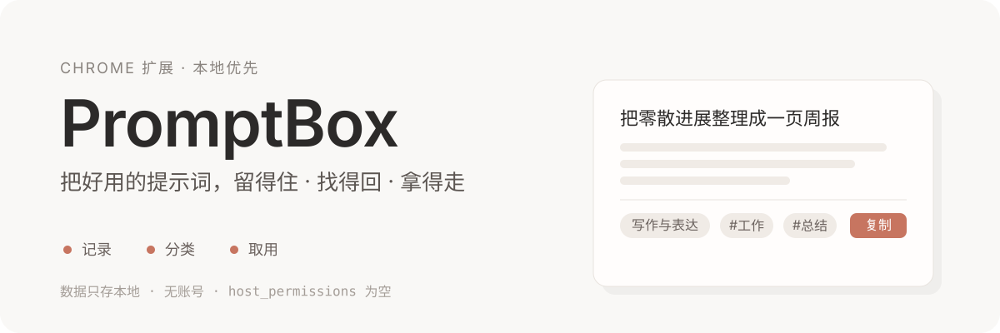
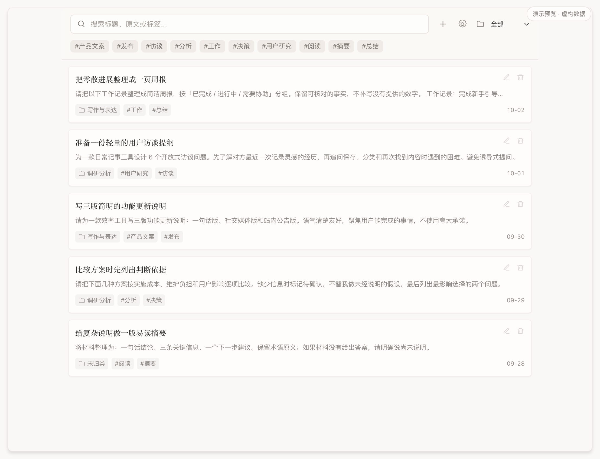
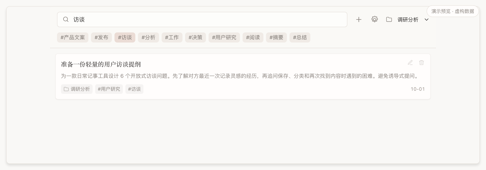
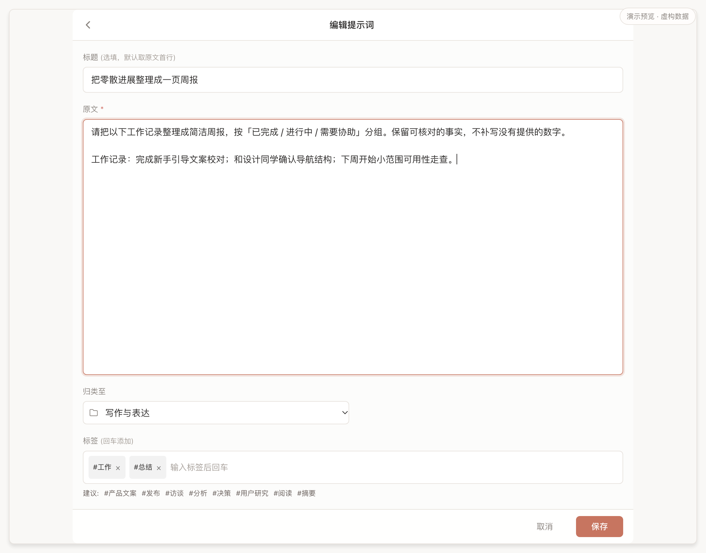
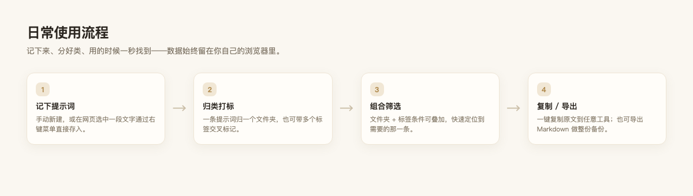

<p align="center">
  
</p>

<p align="center">
  
  
  
  
</p>

常用的提示词容易散落在聊天记录、便签和文档里，复用时又要重新搜索、整理，甚至凭记忆再写一遍。

**PromptBox** 把它们收进一个轻量小本子：**记录、分类、搜索，一键复制取用**。数据只存本地，不接管你的工作流。

## 界面

<p align="center">
  
</p>

**组合筛选：文件夹 + 标签**

<p align="center">
  
</p>

**编辑标题、原文、文件夹与标签**

<p align="center">
  
</p>

> 截图由项目内的隔离预览加载真实 Vue 主界面生成，**条目均为虚构演示数据**，不含真实提示词、账号信息或任何个人内容。

## 主要特性

- **小而直接**：主流程只有「记、分、取」；列表、编辑、设置都围绕提示词本身展开。
- **分类灵活**：一条提示词归属一个文件夹，也可带多个标签；筛选条件可叠加。
- **编辑有保护**：保存时核对打开编辑时的原记录；若另一页面已修改或删除，会保留草稿并提示，不覆盖最新内容。
- **右键即存**：在网页中选中一段文字，通过右键菜单直接保存为新条目。
- **数据在本地**：全部数据存于扩展自己的 `chrome.storage.local`，不申请任何网站访问权限，不上传、无账号。
- **按需备份**：可导出 Markdown 供阅读与整份保存（仅作备份参考，不含可恢复的分类数据）。

## 日常使用流程

<p align="center">
  
</p>

## 安装与使用

需要 Node.js 与 npm。

```bash
npm install
npm run verify     # TypeScript 类型检查 + 架构检查
npm test           # 领域 / 存储 / 导出回归测试
npm run build      # 正式本地构建
```

构建产物位于 `.output/chrome-local/chrome-mv3`。在 Chrome 扩展管理页开启「开发者模式」，选择「加载已解压的扩展程序」并指向该目录即可。

> 首次安装与更新时请保持加载目录及扩展身份稳定；更换目录不等同于迁移已有数据。

## 数据与隐私

- 不向任何网站注入脚本，不自动填写输入框；
- 不申请网站访问权限（`host_permissions` 为空）；
- 没有账号、云同步或社区提示词库，不上传用户数据；
- 数据仅存放于本扩展的 `chrome.storage.local`，不读取或迁移其他扩展的存储。

## 技术栈与结构

Vue 3、TypeScript、WXT、Vite；业务逻辑使用原生 composables，不依赖额外的状态管理库。

代码依赖按单向分层组织，`domain/` 不依赖浏览器 API、DOM 或 Vue，边界由 `npm run check:arch` 校验：

```text
src/
├── entrypoints/   挂载与事件接线（service worker / 侧边栏 / 标签页兜底）
├── ui/            Vue 渲染与状态编排（app/ 为共用主界面）
├── infra/         chrome.storage、剪贴板、Markdown 下载
├── domain/        纯业务规则（提示词 / 文件夹 / 标签 / Markdown 导出）
└── shared/        通用常量与工具
```

## License

采用 [MIT License](https://opensource.org/licenses/MIT)。

---

<p align="center"><sub>PromptBox · Keep your prompts close · Chrome extension</sub></p>
